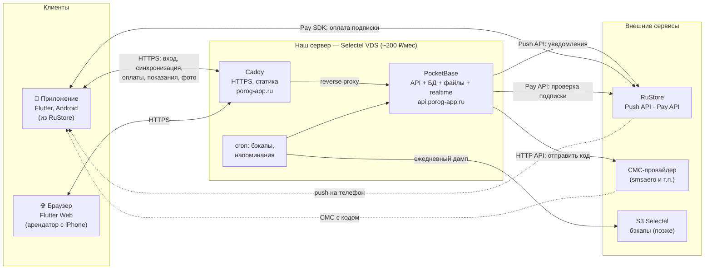

# Архитектура серверной части «Порога»

Схема взаимодействия приложения, сервера и внешних сервисов. Картинка: `server-arkhitektura.png` (генерируется из этого файла, обновлять вместе).

## Потоки по задачам

**Вход по телефону.** Приложение просит код → PocketBase-хук вызывает API СМС-провайдера → пользователь получает СМС → вводит код → сервер выдаёт токен сессии. Договор с СМС-провайдером требует ИП.

**Синхронизация.** Все данные (объекты, договоры, платежи, показания, заявки, фото) пишутся в PocketBase по HTTPS. Приложение работает офлайн с локальной базой и досылает изменения, когда появляется сеть.

**Хозяин ↔ арендатор.** Арендатор входит по коду приглашения (страница `i.html` на `porog-app.ru`). «Я оплатил», показания с фото, заявки о поломках — записи в той же базе; хозяин видит их через realtime-подписку или при следующей синхронизации. Арендатор с iPhone работает через Flutter Web на том же домене.

**Push-уведомления.** Серверный cron (напоминание об оплате, показаниях, конце договора) и события (новая заявка, оплата арендатором) → RuStore Push API → пуш на телефон. В приложение встраивается бесплатный RuStore Push SDK.

**Подписка.** Оплата — внутри приложения через RuStore Pay SDK (требует ИП). Сервер периодически и по вебхуку проверяет статус подписки через RuStore Pay API и хранит его в базе: тариф, «действует до», льготный период.

**Бэкапы.** Ежедневный cron на сервере: дамп базы и файлов → архив в `/opt/backups` (14 дней), позже — копия в S3 Selectel (`deploy/backup.sh`).

## Границы ответственности

| Что | Где живёт |
|---|---|
| Раздача приложения (APK/AAB) | RuStore |
| База, API, файлы, логика, напоминания | Наш VDS: PocketBase |
| Статика `i.html`, Flutter Web | Наш VDS: Caddy |
| Push-уведомления | RuStore Push (триггеры — наш сервер) |
| Оплата подписки | RuStore Pay (проверка — наш сервер) |
| Коды входа | СМС-провайдер (вызов — наш сервер) |
